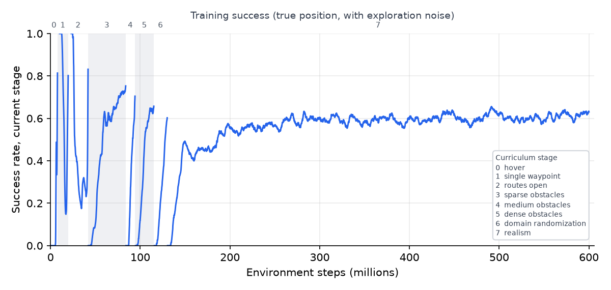

# Autonomous Drone RL

A reinforcement-learning pilot for a simulated quadrotor. Give it a list of waypoints and it
flies them in order, avoids obstacles it has never seen before, and stops to hover at the last
one. Physics and sensing are modelled on a real agile quadrotor and depth camera, and the
trained policy runs in a Streamlit demo with a 3D flight viewer.

With realistic sensing (a forward depth camera, a drifting position estimate, latency) it
completes 98–100% of test routes in forests of every density without a single collision; a
classical straight-line pilot that is even given the true position completes 8–46%.

## What it does

- **Hover:** takes off, holds position, recovers from pushes and gusts
- **Waypoints:** flies a user-given route without stopping at intermediate points
- **Obstacle avoidance:** reacts to trees, walls and pillars using onboard range sensing only (no map)
- **Brisk flight:** cruises between points and slows down only when clutter or the final stop needs it
- **Final hover:** stops and holds position at the last waypoint

## How it works

| Part | Choice | Why |
| --- | --- | --- |
| Algorithm | PPO with an **asymmetric actor-critic** | The actor sees onboard sensing only; the critic also sees privileged ground truth during training, which stabilizes learning under partial observability |
| Actions | **Collective thrust + body rates** at 50 Hz | Found in a benchmark of learned quadrotor control to give the best trade-off of agility and robustness to model errors |
| Inner loop | Simulated firmware rate controller at 250 Hz | Mirrors how real flight controllers accept thrust and body-rate commands |
| Senses | Attitude, velocity, next two waypoints, previous action, and a 64-sector range scan (fine in front, coarse behind); in realistic mode only the front sectors a depth camera would see | No map: avoidance is purely reactive |
| Network | MLP, 2 × 256, ELU | Small enough to run with NumPy in the app |
| Training | 8-stage automatic curriculum: hover → single waypoint → routes → sparse → medium → dense obstacles → domain randomization → sim-to-real realism | Each stage starts once the previous one reaches its success threshold; 20% of episodes replay earlier stages so skills are not forgotten |

**Simulator.** A vectorized NumPy simulator written for this project: 6-DoF rigid body,
first-order motors, quadratic body drag, linear rotor drag (the dominant aerodynamic force at
a few m/s), ground effect, wind with gusts, and cylinders, boxes, ground and arena walls.
Worlds are generated procedurally and every route is checked to be flyable. A light low-pass
filter sits between the policy and the flight controller, because real motors cannot follow
flickering commands.

**Range sensing without blind spots.** A first version used 64 evenly spaced rays and
plateaued at about 13% success in dense obstacles: thin trunks slip between neighbouring rays,
and a check showed it missed 26% of trees 1–2 m away and 41% of trees 2–3 m away. The sensor
is now a *min-pooled sector scan*: each of 64 sectors (azimuth bins × elevation bands) reports
the distance to the closest obstacle surface anywhere inside it, computed exactly in closed
form, so nothing in a sector can be missed. Sectors are 11.25° wide in front (±45°) and
33.75° behind, so the drone learns to point its nose where it flies, which is also the only
direction the realistic depth camera can see. In ideal mode the scan is level; in realistic
mode the camera is body-fixed and tilts with the drone, modelled to first order. Skipping
obstacles out of range keeps the scan exact while making it several times faster.

**Reference platform and drone profiles.** All physical parameters live in a drone profile,
a small TOML file. The default, `sim/profiles/kingfisher.toml`, describes the open-source
[Agilicious](https://agilicious.readthedocs.io/) quadrotor ("Kingfisher"): mass, inertia,
rotor layout, thrust map, motor limits and rotor-drag coefficients. To train for a different
drone, copy the file, fill in that drone's measured values and pass `--profile`; the profile is
stored in checkpoints and exported policies, so evaluation and the app use the same drone. The
realistic sensor model follows the RealSense D435 depth camera (about 85° × 58° field of view,
about 0.3–3 m operating range).

**Rewards.** Progress towards the active waypoint, bonuses for waypoints and for holding the
final hover, and penalties for collisions, closeness to obstacles, jerky commands and time.
Two safety terms matter most: the drone is penalized for closing in on any surface faster
than it could still brake (safe speed √(2·a·d) at distance d, with a = 4 m/s²) and for
tilting past 60°. Without them it learned to dash at 7–9 m/s in open stages and could no
longer dodge trees later; with them it cruises at about 4 m/s and slows down near obstacles.

**Sim-to-real realism.** In realistic mode the actor gets a drifting, noisy position estimate
instead of the true state (like visual-inertial odometry); sees only through a forward-facing
depth camera with distance-dependent noise and dropouts; suffers 0–40 ms actuation latency and
battery sag; and, in the last two stages, also flies with randomized mass, inertia, motors,
body and rotor drag, ground effect and rate-controller gains, in wind. Realistic episodes are
mixed in from the first stage (10%) and rise to 100% in the final stage. An earlier version
switched them on all at once at the end: inputs the policy had only ever seen at one constant
value (the camera mask) suddenly changed, the observation normalizer turned them into extreme
values, and the policy froze in place.
The policy is trained and evaluated under these models; it has **not** been flown on hardware.

## Results

Trained for 600M environment steps with the GPU simulator (8192 drones in parallel), which
took about 1.5 hours on a free Kaggle T4 GPU. Evaluated on 8 fixed test scenarios that are
never used in training, 50 flights each. Success = every waypoint passed and a 2 s hover held
at the last one; collisions end the flight.

| Scenario | PPO, realistic sensing | PPO, ideal sensing | Classical pilot (true state) |
| --- | --- | --- | --- |
| Open field | **100%** (0% crashes) | 100% (0%) | 100% (0%) |
| Forest, 12 trees | **100%** (0%) | 98% (0%) | 44% (56%) |
| Forest, 24 trees | **100%** (0%) | 88% (4%) | 34% (66%) |
| Forest, 36 trees | **98%** (0%) | 64% (10%) | 12% (88%) |
| Walls with gaps | **74%** (14%) | 72% (22%) | 18% (82%) |
| Corridor | **98%** (2%) | 0% (100%) | 60% (38%) |
| Forest in 3 m/s wind + gusts | **98%** (2%) | 78% (6%) | 22% (76%) |
| Push mid-flight | **100%** (0%) | 100% (0%) | 100% (0%) |

The policy averages about 4 m/s. The classical pilot (a straight-line PID pilot set to
cruise at 3 m/s, about 2.2 m/s on average) has no obstacle avoidance, so it is a sanity
check, not a tuned competitor.

How to read the realistic column: the drone can only know where it *thinks* it is. Success is
judged by its onboard position estimate, which drifts during a flight as on a real drone, and
no policy can see that drift. Judged on the true position, it ends on average about 0.3 m from
the final waypoint (the *Final error* column in the full results).



The curve is the *training* metric: success of the current stage, judged on the true position
and with exploration noise on. The final stage levels off at about 60% because most remaining
flights hold the final hover where their drifted estimate says the target is, but end more
than 0.3 m from it. That is why the realistic column above, judged by the onboard estimate and
flown without noise, is higher.

Full per-scenario metrics (speed, route efficiency, final error, minimum clearance) for both
modes and both pilots: [`docs/results/results.md`](docs/results/results.md).

## Quickstart

Python 3.11 or newer.

```bash
python -m venv .venv
source .venv/bin/activate          # Windows: .venv\Scripts\activate
pip --version                      # must be 26.2.2 or newer, see the note below
pip install -r requirements-train.txt
pytest                              # 48 tests, a minute or two
```

> **Security note (October 2026).** After the eMudhra/emSign certificate-authority
> compromise, pip older than 26.2.2 can be tricked into installing tampered packages. A new
> venv may come with an older pip. Upgrade it with a hash check before installing anything:
> take the SHA-256 of `pip-26.2.2-py3-none-any.whl` from
> [pypi.org/project/pip/26.2.2/#files](https://pypi.org/project/pip/26.2.2/#files), then run
> `echo "pip==26.2.2 --hash=sha256:<hash>" > pip.txt && python -m pip install --require-hashes -r pip.txt`.
> The requirements files also pin `certifi>=2026.10.19`. Details:
> [Python Discourse announcement](https://discuss.python.org/t/information-for-python-users-regarding-emudhra-emsign-ca-certificate-security-incident/109576).

### 1. Benchmark this machine

```bash
python -m rl.benchmark --devices cpu,mps
```

Prints steps per second of the NumPy simulator for several batch sizes, and how long a PPO
update takes on the CPU vs. the Apple GPU (MPS); use whichever device gives the faster update.
On a laptop CPU the NumPy simulator trains at roughly 25,000 steps per second. To run the
simulator itself on a GPU, see 2b.

### 2. Train

```bash
python -m rl.train --run-name main                 # full curriculum, 300M steps by default
tensorboard --logdir runs                           # watch progress in the browser
```

Useful options:

| Option | Meaning |
| --- | --- |
| `--stage medium_obstacles` | start at a later stage (name or index) |
| `--no-curriculum` | stay on the start stage |
| `--resume runs/main/checkpoints/latest.pt` | continue training (stage is restored from the checkpoint) |
| `--n-envs 256` | parallel simulated drones |
| `--device cpu\|mps\|auto` | where the network updates run |
| `--total-steps 50e6` | training budget |
| `--profile my_drone.toml` | drone profile (built-in name or path); default `kingfisher` |
| `--sim torch` | run the simulator on the GPU (see below) |

Every run writes `runs/<name>/progress.csv`, TensorBoard logs, `checkpoints/latest.pt`,
a checkpoint at each stage transition, and `final.pt`.

### 2b. Train on a GPU (optional)

`simgpu/` is a PyTorch port of the simulator with the same physics, sensor, rewards and
curriculum. Every drone's state lives on the GPU, so thousands of them step at once.
`tests/test_gpu_equivalence.py` checks it against the NumPy version step by step (same
worlds and actions must give the same observations, rewards and episode ends). Policies
trained either way export and run in the app the same way.

```bash
python -m simgpu.benchmark                          # pick --n-envs from the training speed
python -m rl.train --sim torch --run-name gpu_run   # 4096 drones on the GPU (cuda or mps)
```

With `--sim torch` the defaults become 4096 environments, 32 rollout steps and 8
minibatches per update (131k samples per update). Bigger batches learn a little less per
sample, but each sample is so much cheaper on a GPU that training finishes far sooner.
Worlds are still generated on the CPU, 1024 per stage, when a stage is first reached (a few
seconds), and a few are regenerated every update.

**On Kaggle** (free GPU, sessions up to 12 hours): create a notebook, choose the T4 GPU
accelerator (recent PyTorch builds may not support the older P100) and turn on
internet, then run

```bash
!git clone https://github.com/hamzehjarrarr/drone_nav_rl.git
%cd drone_nav_rl
!python -m simgpu.benchmark
!python -u -m rl.train --sim torch --n-envs 8192 --rollout-steps 16 --run-name kaggle --total-steps 600e6
```

This is the setup of the published policy: on a T4, 8192 drones train at about 125,000 steps
per second. Kaggle images already include PyTorch, NumPy and Matplotlib, so nothing needs
installing.
Use "Save Version → Save & Run All" to train in the background; `runs/` ends up in the
notebook's output. To continue in a new session, add that output as an input and pass
`--resume /kaggle/input/<output>/drone_nav_rl/runs/kaggle/checkpoints/latest.pt`.

### 3. Export the policy for the app

```bash
python -m rl.export runs/main/checkpoints/final.pt app/weights/policy.npz
```

The exporter verifies that the NumPy forward pass matches PyTorch before finishing.

### 4. Evaluate and make figures

```bash
python -m evaluation.evaluate --pilot both --episodes 50
python -m evaluation.render curve runs/main/progress.csv docs/learning_curve.png
python -m evaluation.render flight --scenario forest_medium --out docs/flight.png
```

Test worlds use their own seeds and are never seen in training.

### 5. Run the demo locally

```bash
pip install -r app/requirements.txt
streamlit run app/streamlit_app.py
```

Without `app/weights/policy.npz` the app falls back to the classical reference pilot.

### 6. Deploy on Streamlit Community Cloud

1. Commit `app/weights/policy.npz` and push to GitHub.
2. On share.streamlit.io create an app from the repo with main file `app/streamlit_app.py`.
3. Streamlit Cloud installs `app/requirements.txt` (Streamlit, NumPy, pandas, no PyTorch).

The 3D viewer runs in the visitor's browser and loads Three.js from the jsDelivr CDN; the
server only simulates the flight.

## Project structure

```
sim/          shared NumPy simulator: params, dynamics, rate controller, world, sensors, env, curriculum
simgpu/       the same simulator in PyTorch, for GPU training
rl/           PyTorch training: networks, PPO (CPU and GPU rollouts), train, export, benchmark
evaluation/   test scenarios, rollouts, metrics, figures
app/          Streamlit app, NumPy policy, Three.js viewer
tests/        unit and integration tests
docs/         figures and results for this README
```

## Limitations

- Simulation only; never flown on a real drone. Flying it would need the target drone's
  measured profile, its flight controller's command interface, a real depth-image pipeline and
  a safety layer.
- Aerodynamics are simplified: body and rotor drag, wind and ground effect are modelled;
  thrust changing with airspeed, downwash and aerodynamic torques are not.
- In realistic mode the drone navigates on a drifting position estimate, so it ends about
  0.3 m from the final waypoint on average; holding a precise spot would need an external
  reference (a landmark, GPS or motion capture).
- With *ideal* sensing the policy fails the narrow corridor scenario: its last training stage
  was all camera-only flights, and it lost that skill for full 360° sensing. With the
  realistic camera, the deployment-relevant mode, it flies the corridor 98% of the time.
- Finding the opening in a wall with a camera that sees 3 m ahead is the weakest case (74%).
- The camera tilt model is first-order (it shifts each sector's elevation bands; it does not
  distort azimuths when the drone rolls).
- Obstacles are static primitives (cylinders and boxes); no moving obstacles.
- Avoidance is reactive; with no map, deep dead ends can trap the drone (routes are generated
  to be flyable, but the policy can still pick a poor gap).
- The reference pilot is a sanity check, not a tuned competitor.

## Credits and references

- Quadrotor parameters: [Agilicious](https://arxiv.org/abs/2307.06100) (Foehn et al., Science Robotics 2022)
- Action space: [A Benchmark Comparison of Learned Control Policies for Agile Quadrotor Flight](https://arxiv.org/abs/2202.10796)
- PPO for agile flight: [Champion-level drone racing using deep RL](https://www.nature.com/articles/s41586-023-06419-4) and [Reaching the Limit in Autonomous Racing](https://arxiv.org/abs/2310.10943)
- Asymmetric critic and curriculum: [Learning to Fly in Seconds](https://arxiv.org/abs/2311.13081)
- Depth camera: [Intel RealSense D435](https://www.intel.com/content/www/us/en/ark/products/128255.html)

## License

MIT, see [LICENSE](LICENSE).